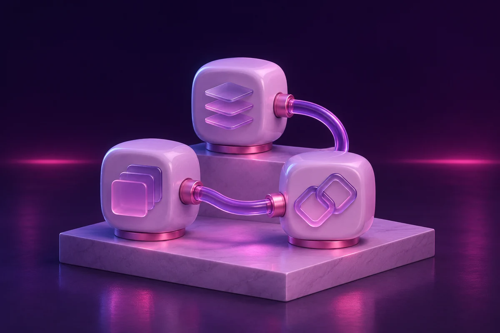

# Rabta

**Typed tools for AI integrations · Raza Labs by Ali Raza**



An original MCP server exposing typed service-catalog, quote, and job-status tools, verified with actual client/server protocol calls.

**[Working browser demo](https://aliraza2025.github.io/serviceops-mcp/)** · [Case study](CASE_STUDY.md) · [Portfolio copy](PORTFOLIO.md)

Stage: independent working prototype by Ali Raza, with AI-assisted implementation.

## What is verified

Official MCP SDK round trips. Tests and original synthetic fixtures are included. Public browser examples are labeled separately from local framework/model execution.

## Run the workbench

Requires Node.js 22 or newer. Python integrations were verified with Python 3.13 on Apple Silicon.

```bash
npm ci
npm test
npm run build
npm start
```

The browser console calls the same calculation functions as the MCP server. The local integration performs an actual SDK client/server call. Start a stdio server with `node mcp.mjs` and configure that command in an MCP client.

## Boundaries

The tools operate only on synthetic records and a fictional price catalog. There is no private CRM, OAuth deployment, scheduling write, or customer messaging integration.

The records, prices, and stories supplied with this project are synthetic. No customers, adoption, revenue, business savings, regulatory certification, or production reliability are claimed.

## Foundation and original contribution

Foundation: https://github.com/modelcontextprotocol/typescript-sdk. The original contribution is the domain workflow, interface, validation, synthetic fixtures, tests, and product reasoning in this repository. Dependencies retain their licenses and are not represented as authored here.

The original browser source is in `public/`. `docs/` is generated for GitHub Pages; run `npm run build` after changing the browser source. Local services bind to loopback. Model endpoints are not exposed through GitHub Pages.

## Next validation

Add a sandbox connector contract and scoped authorization before connecting a real system.

License: [MIT](LICENSE) for this repository's original source. See each dependency and model card for their respective terms.

## Visual identity

Original AI-generated concept artwork for the Raza Labs collection, matched to Ali Raza’s midnight-purple and pink portfolio studio. The cover is illustrative artwork; the interactive demo shows the actual prototype. Generation prompt: [ARTWORK.md](ARTWORK.md).
